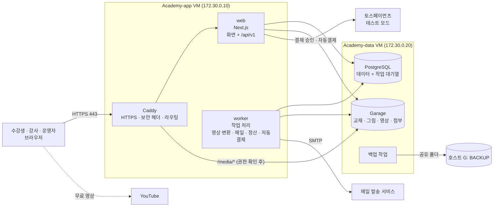

# AIONIT 기술 설계 (v0.2)

- 작성: 2026-11-03
- 기준 문서: `사이트구조_화면목록.md` v0.3, `데이터모델.md` v0.1, `교재_업로드_패키지_규격.md` v0.2, `디자인시스템.md` v0.1
- 원칙: **외부 유료 서비스 없이 테스트 서버 두 대에서 전부 돈다** (메일 발송만 예외). 실오픈 때는 설정만 바꿔 클라우드 · 외부 서비스로 옮긴다.
- 라이브러리 버전은 개발 환경을 만들 때의 최신 안정판으로 정하고 `package.json` 에 고정한다 (이 문서에는 적지 않는다).

---

## 1. 전체 구성



| 구성 요소 | 위치 | 하는 일 |
|---|---|---|
| Caddy | app VM | HTTPS, 보안 헤더, `/` → web, `/media/*` → 권한 확인 후 Garage |
| web | app VM | Next.js. 화면(서버 렌더링)과 API(`/api/v1`) |
| worker | app VM | 오래 걸리거나 정해진 시각에 도는 일 (아래 2.3) |
| PostgreSQL | data VM | 모든 데이터 + 작업 대기열(pg-boss). 외부에 열지 않음 |
| Garage | data VM | 파일 저장 (S3 와 같은 방식). 외부에 직접 열지 않음 |
| (레지스트리 없음) | — | 이미지는 개발 VM 에서 빌드해 앱 VM 으로 직접 옮긴다 (M0 에서 바꿈, `개발기록/M0.md`) |
| 백업 | data VM | 매일 DB · 파일 백업 ➔ 호스트 G: 드라이브 |

- **Redis 를 쓰지 않는다.** 작업 대기열은 PostgreSQL 위에서 도는 pg-boss 로, 세션도 DB 에 둔다. 서버에 올릴 것이 하나 줄고, 백업 대상도 하나로 모인다.
- data VM 은 내부망(`academy-int`)으로만 app VM 과 통신한다.

## 2. 코드 구조 (모노레포)

```text
E:\온라인아카데미_개발_운영관리\   (이 작업 폴더가 저장소 루트)
├─ apps/
│   ├─ web/          Next.js (App Router)
│   │   └─ app/
│   │       ├─ (public)/      홈 · 강의 목록 · 강의 상세 · 구독 안내 · 정책
│   │       ├─ (auth)/        가입 · 로그인 · 비밀번호 재설정
│   │       ├─ (learn)/       내 강의실 · 학습 화면
│   │       ├─ (my)/          마이페이지 · 결제 · 구독 관리
│   │       ├─ instructor/    강사 화면
│   │       ├─ admin/         관리자 화면
│   │       └─ api/v1/        API (웹 · 나중의 앱 · 외부 연동이 함께 쓴다)
│   ├─ worker/       작업 처리 (Node + pg-boss + ffmpeg)
│   └─ mobile/       (나중) Expo 앱
├─ packages/
│   ├─ core/         업무 규칙: 수강권 판단, 가격 · 할인, 환불 계산, 정산 계산, 구독 상태
│   ├─ db/           Drizzle 스키마 · 마이그레이션 · 시드 데이터
│   ├─ contract/     API 입력 · 출력 형식(zod) ➔ OpenAPI 문서 자동 생성
│   ├─ content/      교재 패키지 검사 · 정리(sanitize) · 그림 변환
│   ├─ ui/           디자인 시스템 부품 + 토큰(CSS 변수)
│   └─ config/       TypeScript · ESLint · 공통 설정
├─ infra/
│   ├─ compose/      docker-compose (local · app-vm · data-vm)
│   ├─ caddy/        Caddyfile
│   └─ scripts/      배포 · 백업 · 복구 스크립트
└─ docs/             기획 · 설계 문서 (지금의 docs 폴더)
```

### 2.1 규칙

- **업무 규칙은 `packages/core` 에만 둔다.** 화면 · API · worker 는 core 를 부르기만 한다. 돈 계산(부가세, 환불, 정산)과 수강권 판단은 반드시 core 를 거친다. core 는 DB 를 직접 모르고, 필요한 데이터를 인자로 받는다 → 단위 테스트가 쉽다.
- **모든 바깥 입력은 zod 로 검사한다** (API 요청, 업로드 패키지 manifest, 토스 응답, 환경변수).
- **바뀌는 일(쓰기)은 API(`/api/v1`)로만 한다.** 웹 화면도 같은 API 를 부른다 → 나중의 모바일 앱이 그대로 쓴다. 읽기는 화면(서버 컴포넌트)이 core 를 바로 불러도 된다.
- 금액은 원 단위 정수, 시간은 UTC 저장 · KST 표시, ID 는 UUID v7.

### 2.2 주요 라이브러리

| 영역 | 선택 | 이유 |
|---|---|---|
| 웹 | Next.js (App Router) + React + TypeScript (strict) | 기획 때 정한 스택 |
| DB 접근 | Drizzle ORM + postgres.js | 정한 스택. SQL 에 가깝고 타입이 정확하다 |
| 인증 | Better Auth | 이메일 · 구글 · 카카오(OAuth), DB 세션, 2단계 인증(TOTP) 플러그인 |
| 화면 스타일 | Tailwind CSS + 디자인 토큰(CSS 변수) | `디자인시스템.md` 토큰을 테마로 연결 |
| 작업 대기열 | pg-boss | PostgreSQL 만으로 대기열 · 예약 작업 · 재시도 |
| 파일 저장 | AWS S3 SDK → **Garage** (S3 호환, 직접 운영) | 실오픈 때 S3 · R2 로 주소만 바꾼다. MinIO 는 2025년 10월 무료판 이미지 배포를 멈추고 커뮤니티판을 유지보수 모드로 돌려 보안 패치를 기대할 수 없어 쓰지 않는다 (2026-11-03 결정) |
| 영상 | ffmpeg (worker), hls.js (재생), YouTube IFrame API | |
| 그림 변환 | sharp | WebP · 크기별 변환 |
| HTML 정리 | sanitize-html (서버) | 업로드 규격 3.5 허용 목록 |
| 메일 | Nodemailer (SMTP) | 발송 서비스를 바꿔도 설정만 바꾼다. 개발 PC 는 Mailpit |
| 로그 | pino (JSON 로그) | |
| 테스트 | Vitest (단위 · 통합), Playwright (화면 흐름) | |

### 2.3 worker 가 하는 일

| 작업 | 언제 |
|---|---|
| 영상 변환 (HLS · 암호화 · 자막 변환) | 영상 업로드 직후 |
| 교재 패키지 처리 (검사 · 정리 · 그림 변환) | 업로드 직후 |
| 메일 발송 (가입 인증, 영수증, 알림) | 요청 즉시, 실패 시 재시도 |
| 구독 자동결제 · 재시도 · 갱신 · 가격 변경 안내 | 매일 06:00 KST (`runSubscriptionBilling`, M6) |
| 만료 알림 (D-30 · D-7) | 매일 09:00 KST (`apps/worker/src/reminders.ts`, M5). 사이트 알림은 언제나, 메일은 알림 설정을 따른다 (M7) |
| 학습 시간 집계 (`learning_heartbeats` ➔ `learning_time_daily`) | 매일 00:20 KST, 어제 · 그제 치 (늦게 온 신호까지, 다시 돌려도 같은 값) |
| 월 정산 계산 | 매월 2일 05:00 KST, 지난달 (`calculateLastMonth`, M9). 마지막 날의 학습 시간 집계가 2일 00:20 에 끝나서 1일이 아니라 2일. 운영자가 확정 전까지 다시 돌릴 수 있다 |
| 오래된 원자료 삭제 (heartbeat 90일 등) | 매일 |

## 3. 인증 · 권한 · 보안

> 보안은 운영자(정보보안 전문가)가 기준을 정하고 검토한다. 아래는 기본안이다.

### 3.1 인증 (2026-11-04 확정, M1)

| 항목 | 확정안 | 코드 |
|---|---|---|
| 방식 | 이메일 + 비밀번호, 구글, 카카오 (Better Auth 1.7, API 주소 `/api/v1/auth/*`) | `apps/web/src/server/auth.ts` |
| 세션 | DB 세션 + 서명 쿠키 (`HttpOnly`, `SameSite=Lax`, https 면 `Secure` · `__Secure-` 접두어). **수강생 30일**, 하루에 한 번 연장. **운영자 · 강사 12시간, 연장 없음** (로그인 시각 기준) | `viewer.ts` · `auth.ts` 세션 훅 |
| 비밀번호 | **8자 이상** · 128자까지, 흔한 비밀번호 목록(끝 숫자 · 기호를 떼고도 비교, 서버는 유출 목록 약 4만 9천 개 · M10) · 같은 글자 반복 · 연속 글자 · 이메일 앞부분 · 닉네임이 든 비밀번호 거부. 글자 종류 조합은 강제하지 않음. **argon2id** (메모리 19MiB, 반복 2) | `packages/core/src/auth/password.ts` |
| 이메일 인증 | 인증해야 로그인. 링크 1시간. 인증 전 로그인하면 다시 보냄 | |
| 비밀번호 재설정 | 링크 1시간 · 한 번만. 바꾸면 모든 세션 종료 + 알림 메일. 없는 이메일도 같은 응답 | |
| 가입 여부 노출 | 이미 있는 이메일로 가입해도 화면은 같고, 주인에게 알림 메일. 틀린 비밀번호 · 없는 이메일은 같은 오류 | |
| 2단계 인증 | **운영자 · 강사 필수**(TOTP, 복구 코드 10개), 수강생 선택. 관리자 · 강사 화면은 역할 + 2단계 인증 켜짐 + **그 세션에서 OTP 통과**(`sessions.mfa_verified_at`)가 모두 있어야 한다 → 구글 · 카카오로 로그인한 세션은 들어가기 전에 OTP 를 한 번 더 받는다. "이 기기 기억하기" 쓰지 않음. **구글 · 카카오로만 가입한 계정(비밀번호 없음)** 은 비밀번호 대신 "로그인한 지 15분 안"으로 본인을 확인하고 켜고 끈다 (비밀번호를 따로 만들게 하지 않는다: 관리자 계정의 로그인 방법을 늘리지 않으려고, 2026-11-04 운영자 결정) | `viewer.ts` `staffAccess`, `auth.ts` |
| 로그인 보호 | **IP**: 로그인 1분 10회, 가입 · 재설정 · 인증 메일 10분 5회, OTP 1분 5회. **계정**: 15분 안에 비밀번호 10번 틀리면 15분 잠금(맞는 비밀번호도 거부). 로그인 중 OTP 재확인은 15분 5회 | `packages/core/src/auth/policy.ts` |
| 로그인 기록 | 성공 · 실패 · 잠금 · OTP 를 `login_logs` 에. 이메일 대신 **HMAC(앱 비밀키)** 만 남긴다. 보관 **회원 6개월 · 운영자 · 강사 2년** | `records.ts` |
| 계정 연결 | 같은 이메일이라도 **자동 연결하지 않음** (A-05 안내). 로그인한 상태에서 내 정보 ➔ 연결하기로만. 이미 본인 확인을 했으므로 이메일이 달라도(카카오는 이메일 없음) 연결 허용 | |
| 소셜 가입 | 가입 화면에서 동의 · 만 14세 · 닉네임을 받은 뒤에만 (로그인 화면에서 처음 오면 가입 화면으로). 이름 · 사진은 저장하지 않음. OAuth 토큰은 암호화 저장 | |
| 토큰 저장 | 인증 · 재설정 토큰은 해시로만 DB 에. 세션 토큰은 DB 에 있으나 쿠키는 앱 비밀키로 서명해서 DB 만으로는 세션을 만들 수 없다 | |

### 3.2 권한

| 확인 | 어디서 |
|---|---|
| 로그인했나 | 모든 `(learn)` `(my)` `instructor` `admin` 화면과 쓰기 API |
| 역할 | `instructor/*` 는 강사, `admin/*` 는 운영자 (`user_roles`) |
| 내 것인가 | 강사는 **자기 과정**만, 수강생은 **자기 주문 · 질문**만. API 마다 소유 확인 함수 |
| 볼 수 있나 | 강의 내용 · 자체 서버 영상 키 · 첨부는 **수강권 판단 함수 하나**(core)로만 |

- 권한 검사는 화면이 아니라 **API · 서버 쪽에서** 한다. 화면에서 버튼을 숨기는 것은 편의일 뿐이다.
- `admin/*` 는 Caddy 에서 접속 IP 를 제한할 수 있게 해 둔다 (사무실 · VPN 대역).

### 3.3 기타 보안 기본

| 항목 | 기본안 |
|---|---|
| 보안 헤더 | CSP(스크립트는 자기 도메인 + 요청마다 nonce + `strict-dynamic`, 스타일은 React style 속성 때문에 `'unsafe-inline'`, frame 은 지금 없음 ➔ M2 YouTube · M5 토스 때 더함, `frame-ancestors 'none'`) — `apps/web/src/proxy.ts`. HSTS · `X-Content-Type-Options` · `Referrer-Policy` 는 Caddy. API 응답은 Caddy 가 `default-src 'none'; sandbox` (M10) |
| CSRF | 쿠키 세션 + 쓰기 API 는 `Origin` 확인: 인증 API 는 Better Auth (테스트 환경에서도 켜 둠), `/api/v1` 은 `route()` 공통 처리 (`server/api.ts`) |
| 업로드 | 크기 제한, 확장자 · MIME · 매직 바이트 확인, zip 경로 탈출(`../`) 차단, 압축 폭탄 제한(풀린 크기 상한), SVG 거부. Caddy 요청 크기 상한(운영자 · 강사 API 202MB, 나머지 2MB, M10) |
| 교재 HTML | 서버에서 허용 목록으로 정리한 뒤 저장. 화면은 정리된 HTML 만 그린다 |
| 민감정보 | 주민등록번호 · 계좌 · 자동결제 키는 AES-256-GCM 앱 암호화, 키는 `.env` (키 번호를 함께 저장해 교체 가능) |
| 비밀값 | `.env` 는 서버에만 (권한 600), Git 에 올리지 않는다. 예시는 `.env.example` |
| 기록 | 운영자 작업 `audit_logs`, 개인정보 조회 `pii_access_logs`(회원 검색 · 상세), 로그인 기록 `login_logs` — 덧붙이기만. **DB 트리거**가 UPDATE · DELETE · TRUNCATE 를 막고, 보관 기간 지난 행은 worker 정리 작업(매일 04:10)이 소유자 권한 함수 `aionit_purge_protected_records()` 로만 지운다(DB 시각 기준). **앱 DB 계정 `aionit_app`** (M10, 0012): 기록 · 결제 테이블 UPDATE · DELETE · TRUNCATE 없음, 표 만들기 · 바꾸기 불가. 마이그레이션만 소유자 계정 |
| 의존성 | 주기적 취약점 검사 (`pnpm audit`), lockfile 고정 |
| 점검 결과 | `docs/보안점검.md` (M10: 자동 점검 · 고친 것 · 운영자 체크리스트) |

## 4. 교재 업로드 흐름

```text
강사 · 운영자: zip 업로드 (I-03 / AD-03)
  ➔ web: 크기 확인 ➔ Garage 원본 저장 ➔ course_versions(uploaded) ➔ 작업 등록
  ➔ worker (packages/content):
       1. zip 안전 검사 (경로 탈출 · 크기 · 파일 종류)
       2. course.json · manifest.json 형식 검사 (zod, schema 버전)
       3. content.html 정리 (허용 목록) · 영상 자리 · toc id 대조
       4. 그림 ➔ WebP 여러 크기 (sharp) ➔ Garage
       5. chapters · chapter_assets · video_slots 저장
       6. 결과 보고서(validation_report) ➔ ready 또는 invalid
  ➔ 미리보기 ➔ 검수 요청 ➔ 운영자 승인(AD-04) ➔ published
```

- M2 구현: `packages/content`(검사 · 정리 · 그림), `apps/worker/src/content.ts`(저장), `apps/web/src/server/courses.ts`(올리기 · 공개 · 되돌리기). 올릴 때 web 이 course.json 만 먼저 읽어 과정 · 버전을 확인하고(경로 탈출 등은 여기서 바로 거부), 나머지는 worker 가 한다.
- 교재 그림 주소: `/api/v1/content/<버전 id>/images/<이름>` — 공개 중인 버전: 무료 미리보기 범위에 나오는 그림은 누구나, 나머지는 강의를 볼 수 있는 사람(수강권 · 운영자 · 그 과정 강사)만. 공개 전 버전은 운영자만 (M4 에서 좁힘).
- 영상 자리의 유튜브 영상은 `youtube-nocookie.com` 으로 넣는다 (CSP `frame-src` 도 그 주소만).

## 5. 영상

### 5.1 유튜브 (무료 공개)

- `video_slots.source = youtube` 이면 YouTube IFrame Player API 로 재생. **로그인 · 수강권 확인 없이** 재생된다 (유튜브 정책).
- 시청 진도는 플레이어 이벤트로 받아 `video_watch` 에 저장 (로그인한 경우만).

### 5.2 자체 서버 (수강생 전용, 암호화 HLS)

```text
업로드: 브라우저 ➔ web 에 16MB 조각씩 (3개 동시, 실패하면 다시) ➔ Garage 나눠 올리기(S3 multipart, 버킷 aionit)
        끊기면 같은 파일을 다시 골라 빠진 조각만 올린다
변환:   worker ffmpeg (한 번에 하나, nice 10) ➔ 360p · 720p · 1080p HLS (원본보다 큰 화질은 만들지 않음)
        ➔ 영상마다 AES-128 키 생성 (hls_keys, 앱 비밀값에서 뽑은 키로 AES-256-GCM 감싸 저장)
        ➔ 재생 목록 · 조각 ➔ 영상 전용 버킷 aionit-media 의 v/<영상 id>/hls/
        진행률은 video_assets.progress (운영자 화면이 3초마다 새로 그림)
자막:   srt 를 올리면 web 이 바로 WebVTT 로 바꿔 v/<영상 id>/subs/ko.vtt
재생:   1. 학습 화면에서 ▶ 를 누르면 POST /api/v1/learn/videos/playback ➔ 수강권 확인
        2. web 이 재생 토큰 발급 (사용자 · 영상 · 만료 5분, HMAC 서명). 화면이 4분마다 새로 받는다 (그때 수강권도 다시 본다)
        3. hls.js 가 /media/v/... 재생 목록 · 조각 요청 (토큰은 X-Media-Token 머리글, 주소에 넣지 않음)
           ➔ Caddy forward_auth ➔ web /api/v1/media/check (서명 · 만료 · 영상 일치, DB 안 봄) ➔ Garage 웹 주소(3902, 내부망)
        4. 키 요청 /api/v1/hls/keys/{id} ➔ 토큰(같은 사람 · 같은 영상) + 로그인 + 지금 수강권 다시 확인 ➔ 16바이트 키
        5. 화면 위에 닉네임 · 회원 번호 일부 워터마크 (12초마다 위치 이동). 전체 화면은 영상이 아니라 감싼 상자를 키워
           워터마크가 함께 보인다. 오른쪽 클릭 · 다운로드 · PIP 막음
```

- 업로드를 브라우저 ➔ Garage 직접(미리 서명한 주소)이 아니라 web 을 거치게 바꿨다 (M4): Garage 를 밖에 열지 않기 위해서. 실오픈 때 S3 · R2 로 옮기면 미리 서명한 주소 방식으로 바꿀 수 있다 (`server/videos.ts` 만 바뀐다).
- 영상 버킷을 따로 둔 이유: Garage 웹 주소는 버킷 단위로 인증 없이 내준다. 교재 원본 · 첨부가 있는 `aionit` 버킷은 웹 공개하지 않고, 암호화된 조각만 있는 `aionit-media` 만 웹 공개(내부망 172.30.0.20:3902)한다. 원본은 `aionit` 에 남아 백업되고, 변환 결과는 다시 만들 수 있어 백업하지 않는다.
- 개발 PC 에는 Caddy 가 없어서 web 의 `/media/[...path]` 가 같은 확인을 하고 영상 버킷에서 읽어 준다.

- 이 방식은 일반적인 다운로드 도구는 막지만, 마음먹은 사람이 화면을 녹화하는 것까지는 막지 못한다. 그래서 워터마크로 유출자를 추적한다. 실오픈 뒤 필요하면 멀티 DRM 으로 바꾼다 (재생 단계 3 · 4 만 바뀐다).
- 화면 녹화 영상 위주 강의는 낮은 비트레이트로도 선명하다 → 인코딩 설정을 강의 영상용으로 따로 둔다 (1080p 약 1 ~ 1.5Mbps 목표).

## 6. 결제 (토스페이먼츠, 테스트 모드)

### 6.1 단건 (M5 구현)

```text
구매하기 ➔ POST /api/v1/orders: orders(pending, 30분) + order_items(가격 · 할인 · 부가세 · 수강 기간 · 환불 규정 버전 스냅샷) ➔ 주문서(C-01)
  ➔ 주문서 안에 토스 결제위젯(SDK v2, 결제 수단 · 토스 약관) ➔ 동의 체크 ➔ POST /orders/{id}/agree (동의 기록, 30분 지난 주문서 거절)
  ➔ widgets.requestPayment ➔ 성공 주소 /checkout/{id}/success 로 돌아옴 (paymentKey, orderId, amount)
  ➔ 화면이 POST /api/v1/payments/confirm ➔ web:
         ① 주문 금액과 amount 대조 (다르면 토스를 부르지 않는다) · 이미 수강 중이면 승인하지 않는다
         ② payments(ready) 를 paymentKey 고유 키로 먼저 넣어 자리 잡기 (동시 · 중복 요청은 여기서 하나만)
         ③ 토스 승인 API (비밀 키, 멱등 키) ➔ 응답의 금액 · 주문 번호를 다시 대조 (다르면 바로 취소)
            응답을 못 받으면 토스에 다시 조회해서 판단
         ④ payments(done) · orders(paid) · 수강권 생성(연장권은 끝나는 날 늘림) — 한 트랜잭션. 실패하면 받은 돈을 바로 취소
         ⑤ 영수증 메일 작업 등록
  ➔ 결제 완료 화면 (C-03)
```

- 코드: `apps/web/src/server/commerce.ts`(상품 · 주문 · 승인), `refunds.ts`(환불 · 웹훅), `toss.ts`(토스 어댑터: 승인 · 조회 · 취소, 응답 zod 검사), `toss-fake.ts`(가짜 토스: 통합 테스트 · 개발 서버 화면 흐름 테스트).
- 토스 연동 방식은 **결제위젯**(화면상세기획 C-01 그대로). 토스 문서의 "API 개별 연동" 공개 테스트 키는 2026-11 에 토스가 거부해서(`UNAUTHORIZED_KEY`), 살아 있는 결제위젯 문서용 테스트 키(`test_gck_docs_…` / `test_gsk_docs_…`)를 쓴다. 실오픈 때 운영자 상점의 결제위젯 키로 바꾼다.
- 토스 테스트 모드도 카드 결제는 **카드사 본인 인증 화면(실제 카드사 페이지)** 을 거친다. 그래서 화면 흐름 테스트는 개발 서버 가짜 결제(`TOSS_FAKE=1`, 운영 빌드에서는 꺼짐)로 돌리고, 실제 토스 테스트 결제는 테스트 서버에서 사람이 확인한다.
- CSP: SDK 는 우리 스크립트가 넣으므로 `'strict-dynamic'` 으로 허용, 결제위젯 · 결제창 틀과 SDK 통신은 `frame-src` · `connect-src https://*.tosspayments.com` (`proxy.ts`).
- 토스 웹훅 `POST /api/v1/payments/toss/webhook` (PAYMENT_STATUS_CHANGED): 내용은 믿지 않고 paymentKey 로 토스에 다시 조회해 맞춘다 — 승인 뒤 서버가 멈춰 ready 로 남은 결제 마무리, 토스 상점 관리자에서 직접 한 취소 반영, 끝나지 않은 결제 실패 처리. 받은 기록은 `payment_webhooks`. 토스 개발자센터에 웹훅 주소를 등록하려면 바깥에서 닿는 주소가 필요하다 (외부 공개 때).

### 6.2 구독 (자동결제, M6 구현)

```text
구독 안내 · 신청 /subscribe (P-05 · C-04): 요금제 ➔ 꼭 확인할 내용 ➔ 자동결제 동의 · 약관 · 환불 규정 동의 (따로)
  ➔ POST /api/v1/subscriptions ➔ subscriptions(pending, 금액 스냅샷) ➔ 토스 카드 등록창(requestBillingAuth)
  ➔ /subscribe/{id}/success (customerKey · authKey) ➔ 화면이 POST /subscriptions/{id} {activate}
  ➔ 빌링키 발급 ➔ AES-256-GCM 으로 감싸 저장 ➔ 1회차 결제 ➔ active + 구독 수강권(subscription_catalog, 기간 끝까지) + 영수증
매일 06:00 worker (runSubscriptionBilling, 다시 돌려도 같은 결과):
  1. 해지 예약 · 가격 변경 미동의로 기간이 끝난 구독 ➔ ended
  2. 요금제 가격이 바뀌었으면 적용 회차를 정하고 알림 (내림: 다음 회차 / 올림: 결제일이 30일 이상 남은 회차부터, 동의해야)
  3. 갱신 안내 메일 (연간 30일 · 월간 7일 전)
  4. 결제일이 된 구독 ➔ 다음 회차 결제 (멱등 키 = 구독 + 회차 + 시도 번호, 회차 행을 잠가 겹쳐 돌아도 한 번)
  5. 실패 ➔ past_due + 1 · 3 · 7일 뒤 재시도 (그동안 7일째 끝까지 이용) ➔ 모두 실패하면 ended
해지 예약 (클릭 2번) ➔ 기간 끝에 ended (자동결제 중지, 빌링키 지움, 수강권 끝, 진도 유지). 끝나기 전에는 해지 취소
결제 수단 변경 ➔ 새 카드 등록창 ➔ 새 빌링키. 결제 실패 중이면 바로 다시 결제
즉시 해지 · 환불 ➔ 환불 요청(M-04 와 같은 화면) ➔ 운영자 승인(AD-10) ➔ 토스 취소 ➔ 구독 canceled · 수강권 끝
```

- 회차 기간: 가입한 날(KST)이 기준일, 회차 n 은 기준일 + (n-1) 달(년)에 결제. 회차 이용 기간은 다음 결제일 그날 끝까지 (다음 결제를 그날 안에 하므로 끊기지 않는다). 없는 날은 그달 마지막 날(1월 31일 ➔ 2월 28 · 29일 ➔ 3월 31일).
- 구독 결제도 회차마다 `orders` · `order_items`(product_type subscription, 과정 없음) · `payments`(key_set billing) 를 만들어 결제 내역 · 영수증 · 환불을 단건과 같이 쓴다.
- 토스 키 묶음 둘: 단건은 결제위젯 연동 키, 자동결제는 **API 개별 연동 키** (토스 공개 문서용 키로는 자동결제가 안 된다 ➔ 운영자 본인 테스트 키). 취소 · 조회는 결제한 키 묶음으로 (`payments.key_set`).
- 코드: `packages/payments`(`toss.ts` 토스 어댑터 · `toss-fake.ts` 가짜 토스 · `subscriptions.ts` 구독 — web 과 worker 가 함께 쓰려고 패키지로 옮김), `packages/core/src/commerce/subscription.ts`(회차 · 재시도 · 가격 변경 · 중도 해지 환불), 빌링키 암호화 `@aionit/core/media` `sealBillingKey`.
- 화면: `/subscribe` · `/subscribe/{id}/success|fail` · `/my/subscription`(M-03) · `/my/subscription/card/{id}`(결제 수단 변경) · `/my/entitlements`(M-02) · `/admin/subscriptions`.

### 6.3 환불 (M5 구현)

- 화면(M-04)과 운영자 화면(AD-10)은 같은 core 계산 함수(`calculateRefund`, 규정 버전 `2026-11-v1`)를 쓴다. 계산 근거는 `refunds.calculation` 에 그대로 저장하고, 운영자가 처리할 때 다시 계산한 값은 `decision_calculation` 에 함께 남긴다.
- 환불 금액의 기준은 **요청한 날의 계산** (처리가 늦어져 수강생이 손해 보지 않게). 운영자가 다른 금액으로 하려면 이유를 적어야 한다.
- 운영자가 승인하면 상태를 requested ➔ approved 로 먼저 바꿔 자리를 잡고(두 번 처리 방지) 토스 취소 API (부분 취소, 멱등 키 = 환불 id) ➔ 수강권 종료(연장권은 늘린 날을 거둠) ➔ 메일. 토스가 거절하면 requested 로 되돌리고 이유를 남긴다. 정산 차감은 M9.

## 7. 학습 기록

| 기록 | 방식 |
|---|---|
| 읽은 위치 | 스크롤이 멈추고 5초 뒤 + 화면을 떠날 때(`fetch keepalive`) ➔ `POST /api/v1/learn/progress` ➔ `chapter_progress`. 열기만 하고 떠나면 보내지 않는다 |
| 학습 신호 | 화면이 보이고 2분 안에 활동이 있을 때 30초마다 ➔ `POST /api/v1/learn/heartbeats` (묶음 최대 120개, 24시간 안 · 미래 1분까지만 받음) ➔ `learning_heartbeats`, 교재 머문 시간은 `chapter_progress.text_seconds` |
| 영상 | 유튜브 IFrame API 로 1초마다 재생 위치를 보고 이어 본 구간을 모아 학습 신호(30초)에 실어 보냄 ➔ `video_watch` (구간 합치기, 90% 면 완료, 첫 재생이면 `entitlements.first_used_at`). 신호 하나에 콘텐츠 75초(2배속 + 여유)가 넘으면 버린다 |
| 실습 체크 | 체크 즉시 ➔ `POST /api/v1/learn/checks` ➔ `self_checks` |
| 첨부 받기 | `GET /api/v1/learn/attachments/{id}` ➔ `attachment_downloads` + 첫 이용 |
| 끊겼을 때 | 브라우저(localStorage)에 모아 두었다가 다시 연결되면 차례로 보냄 (읽은 위치는 마지막 것만). 위에 "연결이 끊겼습니다" 띠 |
| 완료 판단 | 저장할 때마다 서버가 다시 판단해 응답으로 돌려준다 (교재 · 영상 · 체크 · 챕터 완료). 한 번 완료한 챕터는 되돌리지 않는다 |

## 8. 서버 배포

### 8.1 환경

| 환경 | 어디 | 구성 |
|---|---|---|
| 개발 | 노트북(코드 · web · worker 개발 서버) + **Academy-dev VM**(PostgreSQL · Garage · Mailpit 컨테이너) | 노트북에서 SSH 터널로 개발 VM 의 서비스에 연결. 개발 서비스는 사무실망에 열지 않는다 |
| 테스트 운영 | Academy-app · Academy-data VM | Docker Compose. 위 1장 구성 |

### 8.2 배포 순서

```text
노트북: 테스트 통과 · 커밋 ➔ 개발 VM 에서 이미지 빌드 (web, worker) ➔ 개발 VM 보관소 ➔ SSH 터널로 앱 VM 이 바뀐 층만 받음
  ➔ app VM: 이미지 받기 ➔ DB 마이그레이션 실행 ➔ web · worker 다시 시작 (상태 확인 후 전환)
  ➔ 실패하면 이전 이미지로 되돌리기
```

- 서버에서는 빌드하지 않는다 (메모리 절약). 배포는 스크립트 하나(`infra/scripts/deploy`)로.
- 마이그레이션은 **되돌릴 수 있게** 작성하고, 배포 전 백업을 먼저 받는다.

### 8.3 외부 접속

- 지금: VM SSH 는 호스트를 거쳐 접속(ProxyJump), 웹은 아직 외부에 열지 않음.
- 사무실 안에서 시험할 때: app VM 에 브리지 랜카드 추가 또는 호스트 포트 연결 ➔ `https://<내부 주소>` (내부 인증서).
- 외부 공개 때: 도메인 + 공인 IP NAT(80 · 443 ➔ app VM) + Let's Encrypt (Caddy 자동).

## 9. 백업 · 복구

| 대상 | 방법 | 주기 · 보관 |
|---|---|---|
| PostgreSQL | `pg_dump` (압축) | 매일 · 7일, 매주 · 4주, 매월 · 6개월 |
| 파일 저장소 | `rclone sync` (바뀐 것만, S3 방식, **읽기 전용 키**) ➔ G: `files/aionit/`. 바뀌거나 지워진 파일은 `files/changed/<날짜>/` 로 35일 | 매일 (DB 백업과 같은 스크립트, M2) |
| 설정 (`.env`, Caddyfile, compose) | 암호화 압축 | 바뀔 때마다 |
| VM 전체 | VirtualBox 스냅샷 | 큰 변경 전 |

- 백업 위치: VirtualBox 공유 폴더로 data VM 에 붙인 **호스트 G:\AIONIT-backup** (VM 안 systemd mount 단위. 공유가 없어도 부팅은 막히지 않는다). 운영 방법은 `infra/README.md`.
- **복구 훈련을 매달 한 번** 한다 (백업으로 새 DB 를 만들어 확인). 복구가 안 되는 백업은 백업이 아니다.
- G: 는 같은 물리 서버 안이므로, 중요한 백업은 NAS(F:)에도 한 부 복사한다.

## 10. 운영 관측

| 항목 | 테스트 기간 (외부 서비스 없음) |
|---|---|
| 로그 | 컨테이너 표준 출력 ➔ Docker json-file (10MB × 5), 시스템 저널 500MB · 3개월, 백업 기록 logrotate (M10, `infra/README.md` 로그). 오류는 추적 ID |
| 상태 확인 | `/api/health` (web), worker 대기열 상태 |
| 감시 | **Gatus** (app VM 에 컨테이너, 설정은 `infra/monitor/config.yaml`) ➔ 문제 시 메일. 백업 · worker 는 푸시(25시간 · 2시간 안 오면 실패). 2026-11-05 운영자 결정: Uptime Kuma 대신 (관리자 계정 · 화면에서만 바꾸는 설정이 없고, 설정이 git 에 남아 복구가 쉽다) |
| 오류 추적 | 로그 + 오류 화면의 추적 ID. 실오픈 때 오류 추적 서비스 검토 |
| 지표 | 2단계: Prometheus + Grafana (서버 자원, 응답 시간) |

## 11. 테스트

| 종류 | 대상 | 기준 |
|---|---|---|
| 단위 (Vitest) | `packages/core` 전부 — 수강권, 가격 · 부가세, 환불 단계, 정산 배분, 구독 상태 | 경계값 포함. **돈 계산은 예시 표를 테스트로 옮긴다** |
| 통합 (Vitest + 테스트 DB) | API, 결제 승인 흐름(토스 테스트 모드), 업로드 처리 | 권한 없는 요청이 막히는지 함께 확인 |
| 화면 흐름 (Playwright) | 가입 ➔ 구매 ➔ 학습 ➔ 환불, 구독 ➔ 해지, 강사 업로드 ➔ 검수 ➔ 공개 | 데스크톱 · 모바일 폭 |
| 보안 | 권한 우회, 업로드 공격 파일, XSS 시도 | 운영자 검토 |

## 12. 결정 필요

| 번호 | 질문 | 추천 |
|---|---|---|
| ~~T1~~ | 코드 저장소 | **결정 (2026-11-03)**: GitHub 비공개 저장소 https://github.com/StudyNLab/academy (원격 이름 `origin`, 기본 브랜치 `main`) |
| ~~T2~~ | 보안 기본안 (3장) | **결정 (2026-11-04)**: 운영자가 비밀번호 8자 · 계정 10회/15분 잠금 · 운영자 세션 12시간 · 로그인 기록 회원 6개월/운영자 2년 확정. 나머지는 3장 확정안 |
