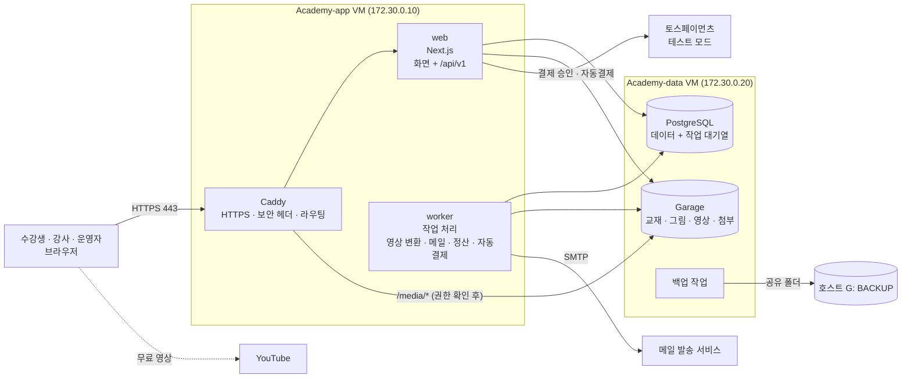

# AIONIT 기술 설계 (v0.2)

- 작성: 2026-11-03
- 기준 문서: `사이트구조_화면목록.md` v0.3, `데이터모델.md` v0.1, `교재_업로드_패키지_규격.md` v0.2, `디자인시스템.md` v0.1
- 원칙: **외부 유료 서비스 없이 테스트 서버 두 대에서 전부 돈다** (메일 발송만 예외). 실오픈 때는 설정만 바꿔 클라우드 · 외부 서비스로 옮긴다.
- 라이브러리 버전은 개발 환경을 만들 때의 최신 안정판으로 정하고 `package.json` 에 고정한다 (이 문서에는 적지 않는다).

---

## 1. 전체 구성



| 구성 요소 | 위치 | 하는 일 |
|---|---|---|
| Caddy | app VM | HTTPS, 보안 헤더, `/` → web, `/media/*` → 권한 확인 후 Garage |
| web | app VM | Next.js. 화면(서버 렌더링)과 API(`/api/v1`) |
| worker | app VM | 오래 걸리거나 정해진 시각에 도는 일 (아래 2.3) |
| PostgreSQL | data VM | 모든 데이터 + 작업 대기열(pg-boss). 외부에 열지 않음 |
| Garage | data VM | 파일 저장 (S3 와 같은 방식). 외부에 직접 열지 않음 |
| (레지스트리 없음) | — | 이미지는 개발 VM 에서 빌드해 앱 VM 으로 직접 옮긴다 (M0 에서 바꿈, `개발기록/M0.md`) |
| 백업 | data VM | 매일 DB · 파일 백업 ➔ 호스트 G: 드라이브 |

- **Redis 를 쓰지 않는다.** 작업 대기열은 PostgreSQL 위에서 도는 pg-boss 로, 세션도 DB 에 둔다. 서버에 올릴 것이 하나 줄고, 백업 대상도 하나로 모인다.
- data VM 은 내부망(`academy-int`)으로만 app VM 과 통신한다.

## 2. 코드 구조 (모노레포)

```text
E:\온라인아카데미_개발_운영관리\   (이 작업 폴더가 저장소 루트)
├─ apps/
│   ├─ web/          Next.js (App Router)
│   │   └─ app/
│   │       ├─ (public)/      홈 · 강의 목록 · 강의 상세 · 구독 안내 · 정책
│   │       ├─ (auth)/        가입 · 로그인 · 비밀번호 재설정
│   │       ├─ (learn)/       내 강의실 · 학습 화면
│   │       ├─ (my)/          마이페이지 · 결제 · 구독 관리
│   │       ├─ instructor/    강사 화면
│   │       ├─ admin/         관리자 화면
│   │       └─ api/v1/        API (웹 · 나중의 앱 · 외부 연동이 함께 쓴다)
│   ├─ worker/       작업 처리 (Node + pg-boss + ffmpeg)
│   └─ mobile/       (나중) Expo 앱
├─ packages/
│   ├─ core/         업무 규칙: 수강권 판단, 가격 · 할인, 환불 계산, 정산 계산, 구독 상태
│   ├─ db/           Drizzle 스키마 · 마이그레이션 · 시드 데이터
│   ├─ contract/     API 입력 · 출력 형식(zod) ➔ OpenAPI 문서 자동 생성
│   ├─ content/      교재 패키지 검사 · 정리(sanitize) · 그림 변환
│   ├─ ui/           디자인 시스템 부품 + 토큰(CSS 변수)
│   └─ config/       TypeScript · ESLint · 공통 설정
├─ infra/
│   ├─ compose/      docker-compose (local · app-vm · data-vm)
│   ├─ caddy/        Caddyfile
│   └─ scripts/      배포 · 백업 · 복구 스크립트
└─ docs/             기획 · 설계 문서 (지금의 docs 폴더)
```

### 2.1 규칙

- **업무 규칙은 `packages/core` 에만 둔다.** 화면 · API · worker 는 core 를 부르기만 한다. 돈 계산(부가세, 환불, 정산)과 수강권 판단은 반드시 core 를 거친다. core 는 DB 를 직접 모르고, 필요한 데이터를 인자로 받는다 → 단위 테스트가 쉽다.
- **모든 바깥 입력은 zod 로 검사한다** (API 요청, 업로드 패키지 manifest, 토스 응답, 환경변수).
- **바뀌는 일(쓰기)은 API(`/api/v1`)로만 한다.** 웹 화면도 같은 API 를 부른다 → 나중의 모바일 앱이 그대로 쓴다. 읽기는 화면(서버 컴포넌트)이 core 를 바로 불러도 된다.
- 금액은 원 단위 정수, 시간은 UTC 저장 · KST 표시, ID 는 UUID v7.

### 2.2 주요 라이브러리

| 영역 | 선택 | 이유 |
|---|---|---|
| 웹 | Next.js (App Router) + React + TypeScript (strict) | 기획 때 정한 스택 |
| DB 접근 | Drizzle ORM + postgres.js | 정한 스택. SQL 에 가깝고 타입이 정확하다 |
| 인증 | Better Auth | 이메일 · 구글 · 카카오(OAuth), DB 세션, 2단계 인증(TOTP) 플러그인 |
| 화면 스타일 | Tailwind CSS + 디자인 토큰(CSS 변수) | `디자인시스템.md` 토큰을 테마로 연결 |
| 작업 대기열 | pg-boss | PostgreSQL 만으로 대기열 · 예약 작업 · 재시도 |
| 파일 저장 | AWS S3 SDK → **Garage** (S3 호환, 직접 운영) | 실오픈 때 S3 · R2 로 주소만 바꾼다. MinIO 는 2025년 10월 무료판 이미지 배포를 멈추고 커뮤니티판을 유지보수 모드로 돌려 보안 패치를 기대할 수 없어 쓰지 않는다 (2026-11-03 결정) |
| 영상 | ffmpeg (worker), hls.js (재생), YouTube IFrame API | |
| 그림 변환 | sharp | WebP · 크기별 변환 |
| HTML 정리 | sanitize-html (서버) | 업로드 규격 3.5 허용 목록 |
| 메일 | Nodemailer (SMTP) | 발송 서비스를 바꿔도 설정만 바꾼다. 개발 PC 는 Mailpit |
| 로그 | pino (JSON 로그) | |
| 테스트 | Vitest (단위 · 통합), Playwright (화면 흐름) | |

### 2.3 worker 가 하는 일

| 작업 | 언제 |
|---|---|
| 영상 변환 (HLS · 암호화 · 자막 변환) | 영상 업로드 직후 |
| 교재 패키지 처리 (검사 · 정리 · 그림 변환) | 업로드 직후 |
| 메일 발송 (가입 인증, 영수증, 알림) | 요청 즉시, 실패 시 재시도 |
| 구독 자동결제 · 재시도 | 매일 정해진 시각 |
| 만료 알림 (D-30 · D-7) | 매일 |
| 학습 시간 집계 (`learning_heartbeats` ➔ `learning_time_daily`) | 매일 새벽 |
| 월 정산 계산 | 매월 1일 새벽 (운영자가 다시 돌릴 수도 있음) |
| 오래된 원자료 삭제 (heartbeat 90일 등) | 매일 |

## 3. 인증 · 권한 · 보안

> 보안은 운영자(정보보안 전문가)가 기준을 정하고 검토한다. 아래는 기본안이다.

### 3.1 인증

| 항목 | 기본안 |
|---|---|
| 방식 | 이메일 + 비밀번호, 구글, 카카오 (Better Auth) |
| 세션 | DB 세션 + 쿠키 (`HttpOnly`, `Secure`, `SameSite=Lax`). 30일, 활동하면 연장. 모바일 앱은 나중에 토큰 방식 추가 |
| 비밀번호 | 길이 8 이상, 흔한 비밀번호 목록 거부, 해시 저장 (scrypt 또는 argon2id) |
| 2단계 인증 | **운영자 · 강사는 필수**(TOTP), 수강생은 선택 |
| 로그인 보호 | 로그인 · 가입 · 비밀번호 재설정에 횟수 제한 (IP · 계정별), 실패 기록 |
| 계정 연결 | 같은 이메일의 다른 로그인 방식은 **확인한 뒤** 연결 (A-05). 자동 연결하지 않는다 (계정 탈취 방지) |

### 3.2 권한

| 확인 | 어디서 |
|---|---|
| 로그인했나 | 모든 `(learn)` `(my)` `instructor` `admin` 화면과 쓰기 API |
| 역할 | `instructor/*` 는 강사, `admin/*` 는 운영자 (`user_roles`) |
| 내 것인가 | 강사는 **자기 과정**만, 수강생은 **자기 주문 · 질문**만. API 마다 소유 확인 함수 |
| 볼 수 있나 | 강의 내용 · 자체 서버 영상 키 · 첨부는 **수강권 판단 함수 하나**(core)로만 |

- 권한 검사는 화면이 아니라 **API · 서버 쪽에서** 한다. 화면에서 버튼을 숨기는 것은 편의일 뿐이다.
- `admin/*` 는 Caddy 에서 접속 IP 를 제한할 수 있게 해 둔다 (사무실 · VPN 대역).

### 3.3 기타 보안 기본

| 항목 | 기본안 |
|---|---|
| 보안 헤더 | CSP(스크립트는 자기 도메인 + nonce, frame 은 YouTube · 토스만), HSTS, `X-Content-Type-Options`, `Referrer-Policy`, `frame-ancestors 'none'` |
| CSRF | 쿠키 세션 + 쓰기 API 는 `Origin` 확인 (Better Auth 기본 + API 공통 미들웨어) |
| 업로드 | 크기 제한, 확장자 · MIME · 매직 바이트 확인, zip 경로 탈출(`../`) 차단, 압축 폭탄 제한(풀린 크기 상한), SVG 거부 |
| 교재 HTML | 서버에서 허용 목록으로 정리한 뒤 저장. 화면은 정리된 HTML 만 그린다 |
| 민감정보 | 주민등록번호 · 계좌 · 자동결제 키는 AES-256-GCM 앱 암호화, 키는 `.env` (키 번호를 함께 저장해 교체 가능) |
| 비밀값 | `.env` 는 서버에만 (권한 600), Git 에 올리지 않는다. 예시는 `.env.example` |
| 기록 | 운영자 작업 `audit_logs`, 개인정보 조회 `pii_access_logs`, 로그인 기록 — 덧붙이기만 (DB 권한으로 강제) |
| 의존성 | 주기적 취약점 검사 (`pnpm audit`), lockfile 고정 |

## 4. 교재 업로드 흐름

```text
강사 · 운영자: zip 업로드 (I-03 / AD-03)
  ➔ web: 크기 확인 ➔ Garage 원본 저장 ➔ course_versions(uploaded) ➔ 작업 등록
  ➔ worker (packages/content):
       1. zip 안전 검사 (경로 탈출 · 크기 · 파일 종류)
       2. course.json · manifest.json 형식 검사 (zod, schema 버전)
       3. content.html 정리 (허용 목록) · 영상 자리 · toc id 대조
       4. 그림 ➔ WebP 여러 크기 (sharp) ➔ Garage
       5. chapters · chapter_assets · video_slots 저장
       6. 결과 보고서(validation_report) ➔ ready 또는 invalid
  ➔ 미리보기 ➔ 검수 요청 ➔ 운영자 승인(AD-04) ➔ published
```

## 5. 영상

### 5.1 유튜브 (무료 공개)

- `video_slots.source = youtube` 이면 YouTube IFrame Player API 로 재생. **로그인 · 수강권 확인 없이** 재생된다 (유튜브 정책).
- 시청 진도는 플레이어 이벤트로 받아 `video_watch` 에 저장 (로그인한 경우만).

### 5.2 자체 서버 (수강생 전용, 암호화 HLS)

```text
업로드: 브라우저 ➔ Garage 로 직접 (미리 서명한 주소, 큰 파일은 나눠 올리기)
변환:   worker ffmpeg ➔ 360p · 720p · 1080p HLS
        ➔ 영상마다 AES-128 키 생성 (hls_keys, 암호화 저장)
        ➔ 조각 파일 · 재생 목록 ➔ Garage (영상 폴더)
        ➔ 자막 srt ➔ WebVTT
재생:   1. 학습 화면이 web 에 재생 요청 ➔ 수강권 확인
        2. web 이 짧게 쓰는 재생 토큰 발급 (사용자 · 영상 · 만료 5분, 서명)
        3. hls.js 가 /media/... 재생 목록 · 조각 요청 ➔ Caddy 가 web 에 토큰 확인(forward_auth) ➔ Garage
        4. 키 요청 /api/v1/hls/keys/{id} ➔ 토큰 + 수강권 다시 확인 ➔ 키 전달
        5. 화면 위에 닉네임 워터마크 (위치 이동)
```

- 이 방식은 일반적인 다운로드 도구는 막지만, 마음먹은 사람이 화면을 녹화하는 것까지는 막지 못한다. 그래서 워터마크로 유출자를 추적한다. 실오픈 뒤 필요하면 멀티 DRM 으로 바꾼다 (재생 단계 3 · 4 만 바뀐다).
- 화면 녹화 영상 위주 강의는 낮은 비트레이트로도 선명하다 → 인코딩 설정을 강의 영상용으로 따로 둔다 (1080p 약 1 ~ 1.5Mbps 목표).

## 6. 결제 (토스페이먼츠, 테스트 모드)

### 6.1 단건

```text
구매하기 ➔ web: orders(pending) + order_items(가격 스냅샷) 생성 ➔ 주문서(C-01)
  ➔ 토스 결제창 ➔ 성공 주소로 돌아옴 (paymentKey, orderId, amount)
  ➔ web: ① 주문 금액과 amount 대조 ② 토스 승인 API 호출 (비밀 키, 서버에서만)
         ③ payments(done) · orders(paid) · entitlements 생성 — 한 트랜잭션
         ④ 영수증 메일 작업 등록
  ➔ 결제 완료 화면
```

- 같은 승인 요청이 두 번 와도 한 번만 처리 (`provider_payment_key` 고유 + 멱등 키).
- 토스 웹훅도 받아서 상태를 맞춘다 (결제 취소 등). 웹훅은 토스에 다시 조회해 확인한 뒤 반영한다.

### 6.2 구독 (자동결제)

```text
구독 신청 ➔ 토스 카드 등록 ➔ billingKey 발급 ➔ 암호화 저장
  ➔ 첫 결제 (서버에서 billingKey 로 승인) ➔ subscriptions(active) + 수강권(subscription_catalog)
매일 worker: 결제일이 된 구독 ➔ 자동결제 (멱등 키 = 구독 id + 회차)
  ➔ 실패: past_due + 1 · 3 · 7일 뒤 재시도 + 메일 ➔ 계속 실패: ended
해지 예약 ➔ 기간 끝에 ended (자동결제 중지, 수강권 종료, 진도 유지)
```

### 6.3 환불

- 화면(M-04)과 운영자 화면(AD-10)은 같은 core 계산 함수를 쓴다. 계산 근거는 `refunds.calculation` 에 그대로 저장.
- 운영자가 승인하면 토스 취소 API (부분 취소) ➔ 수강권 종료 ➔ 메일 ➔ 정산에서 차감.

## 7. 학습 기록

| 기록 | 방식 |
|---|---|
| 읽은 위치 | 스크롤이 멈추고 5초 뒤 + 화면을 떠날 때(`sendBeacon`) ➔ `chapter_progress` |
| 학습 신호 | 화면이 보이고 활동이 있을 때 30초마다 묶어서 보냄 ➔ `learning_heartbeats` |
| 영상 | 10초마다 본 구간 ➔ `video_watch` |
| 실습 체크 | 체크 즉시 ➔ `self_checks` |
| 끊겼을 때 | 브라우저에 모아 두었다가 다시 연결되면 보냄 |

## 8. 서버 배포

### 8.1 환경

| 환경 | 어디 | 구성 |
|---|---|---|
| 개발 | 노트북(코드 · web · worker 개발 서버) + **Academy-dev VM**(PostgreSQL · Garage · Mailpit 컨테이너) | 노트북에서 SSH 터널로 개발 VM 의 서비스에 연결. 개발 서비스는 사무실망에 열지 않는다 |
| 테스트 운영 | Academy-app · Academy-data VM | Docker Compose. 위 1장 구성 |

### 8.2 배포 순서

```text
노트북: 테스트 통과 · 커밋 ➔ 개발 VM 에서 이미지 빌드 (web, worker) ➔ docker save · load 로 앱 VM 에 옮김
  ➔ app VM: 이미지 받기 ➔ DB 마이그레이션 실행 ➔ web · worker 다시 시작 (상태 확인 후 전환)
  ➔ 실패하면 이전 이미지로 되돌리기
```

- 서버에서는 빌드하지 않는다 (메모리 절약). 배포는 스크립트 하나(`infra/scripts/deploy`)로.
- 마이그레이션은 **되돌릴 수 있게** 작성하고, 배포 전 백업을 먼저 받는다.

### 8.3 외부 접속

- 지금: VM SSH 는 호스트를 거쳐 접속(ProxyJump), 웹은 아직 외부에 열지 않음.
- 사무실 안에서 시험할 때: app VM 에 브리지 랜카드 추가 또는 호스트 포트 연결 ➔ `https://<내부 주소>` (내부 인증서).
- 외부 공개 때: 도메인 + 공인 IP NAT(80 · 443 ➔ app VM) + Let's Encrypt (Caddy 자동).

## 9. 백업 · 복구

| 대상 | 방법 | 주기 · 보관 |
|---|---|---|
| PostgreSQL | `pg_dump` (압축) | 매일 · 7일, 매주 · 4주, 매월 · 6개월 |
| 파일 저장소 | `rclone sync` (바뀐 것만, S3 방식) | 매일 |
| 설정 (`.env`, Caddyfile, compose) | 암호화 압축 | 바뀔 때마다 |
| VM 전체 | VirtualBox 스냅샷 | 큰 변경 전 |

- 백업 위치: VirtualBox 공유 폴더로 data VM 에 붙인 **호스트 G:\AIONIT-backup** (VM 안 systemd mount 단위. 공유가 없어도 부팅은 막히지 않는다). 운영 방법은 `infra/README.md`.
- **복구 훈련을 매달 한 번** 한다 (백업으로 새 DB 를 만들어 확인). 복구가 안 되는 백업은 백업이 아니다.
- G: 는 같은 물리 서버 안이므로, 중요한 백업은 NAS(F:)에도 한 부 복사한다.

## 10. 운영 관측

| 항목 | 테스트 기간 (외부 서비스 없음) |
|---|---|
| 로그 | JSON 로그 (pino) ➔ 파일, 날짜별 회전. 요청마다 추적 ID |
| 상태 확인 | `/api/health` (web), worker 대기열 상태 |
| 감시 | Uptime Kuma (app VM 에 컨테이너) ➔ 문제 시 메일 |
| 오류 추적 | 로그 + 오류 화면의 추적 ID. 실오픈 때 오류 추적 서비스 검토 |
| 지표 | 2단계: Prometheus + Grafana (서버 자원, 응답 시간) |

## 11. 테스트

| 종류 | 대상 | 기준 |
|---|---|---|
| 단위 (Vitest) | `packages/core` 전부 — 수강권, 가격 · 부가세, 환불 단계, 정산 배분, 구독 상태 | 경계값 포함. **돈 계산은 예시 표를 테스트로 옮긴다** |
| 통합 (Vitest + 테스트 DB) | API, 결제 승인 흐름(토스 테스트 모드), 업로드 처리 | 권한 없는 요청이 막히는지 함께 확인 |
| 화면 흐름 (Playwright) | 가입 ➔ 구매 ➔ 학습 ➔ 환불, 구독 ➔ 해지, 강사 업로드 ➔ 검수 ➔ 공개 | 데스크톱 · 모바일 폭 |
| 보안 | 권한 우회, 업로드 공격 파일, XSS 시도 | 운영자 검토 |

## 12. 결정 필요

| 번호 | 질문 | 추천 |
|---|---|---|
| ~~T1~~ | 코드 저장소 | **결정 (2026-11-03)**: GitHub 비공개 저장소 https://github.com/StudyNLab/academy (원격 이름 `origin`, 기본 브랜치 `main`) |
| T2 | 보안 기본안 (3장) | 운영자 검토 후 확정 |
