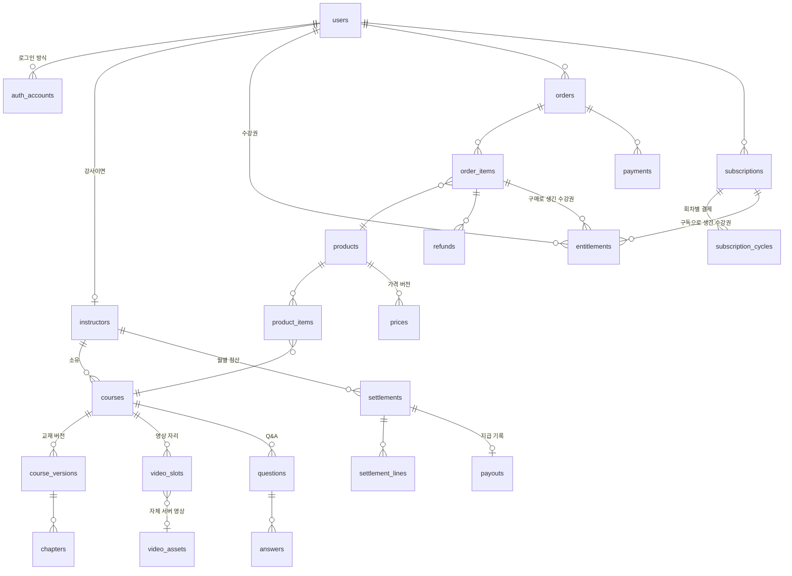

# 데이터 모델 설계 (v0.1)

- 작성: 2026-11-03 / 결정 D1~D3 확정 (2026-11-03)
- 기준 문서: `사이트구조_화면목록.md` v0.3, `교재_업로드_패키지_규격.md` v0.2
- DB: PostgreSQL, ORM: Drizzle. 이 문서는 **무엇을 저장하고 서로 어떻게 이어지는지**를 정한다. 실제 컬럼 타입 · 인덱스는 코드(스키마)에서 확정한다.

---

## 1. 설계 원칙

| 원칙 | 내용 | 왜 |
|---|---|---|
| **스냅샷** | 주문할 때의 가격 · 수강 기간 · 환불 규정, 정산할 때의 배분 정책 버전을 그 기록 안에 복사해 둔다 | 나중에 가격이나 정책을 바꿔도 과거 주문 · 정산이 바뀌지 않는다. 분쟁 때 근거가 된다 |
| **버전 + 시행일** | 가격, 배분 정책, 약관, 교재는 고치지 않고 **새 버전**을 만든다 | "언제든 바꿀 수 있게" + "과거는 그대로" |
| **수강권 하나로 판단** | 강의를 볼 수 있는지는 오직 `entitlements` 로 판단한다. 구매 · 구독 · 운영자 발급 · 무료 모두 수강권을 만든다 | 쿠폰, 이벤트, 기업 단체 구매가 생겨도 "수강권을 만드는 방법"만 늘리면 된다 |
| **금액은 원 단위 정수** | 소수점 없는 정수(`bigint`). 공급가액 · 부가세를 따로 저장 | 소수 계산 오차가 없다 |
| **ID** | 외부에 보이는 ID는 UUID v7 (시간순 정렬되는 무작위 ID) | 순번 ID는 회원 수 · 주문 수를 짐작하게 하고, 남의 주문 번호를 맞혀 보는 공격에 약하다 |
| **시간** | 모두 `timestamptz` (UTC 저장, 화면은 KST) | |
| **지우지 않는 기록** | 결제 · 환불 · 정산 · 관리자 작업 기록 · 개인정보 접근 기록은 고치거나 지우지 않고 덧붙이기만 한다 | 감사 · 분쟁 대응 · 법정 보관 |
| **민감정보 암호화** | 주민등록번호, 계좌번호, 자동결제 키(billing key)는 앱에서 암호화(AES-256-GCM)해 저장. 키는 DB 밖(환경변수 ➔ 실오픈 때 키 관리 서비스) | DB가 유출돼도 읽을 수 없게. 개인정보 안전성 확보조치 기준 |

## 2. 전체 그림



## 3. 도메인별 테이블

표기: **굵게** = 꼭 필요한 핵심 필드, 🔒 = 암호화 저장, 📌 = 스냅샷(그때 값 복사)

### 3.1 회원 · 인증

| 테이블 | 무엇 | 주요 필드 |
|---|---|---|
| `users` | 회원 한 명 | **id**, **email**(고유 · 대소문자 무시. 라이브러리가 비워 둘 수 없어, 이메일을 주지 않는 카카오 회원 · 탈퇴 회원은 `…@….invalid` 자리표시 주소), email_verified, **nickname**(고유 · 대소문자 무시, Q&A 표시, 탈퇴하면 비움), nickname_changed_at, age14_confirmed_at(만 14세 이상 확인 시각), status(`active`/`suspended`/`withdrawn`), two_factor_enabled, created_at, withdrawn_at. 실명(name) · 사진은 받지 않는다 (M1 에서 바꿈: 최소 수집) |
| `auth_accounts` | 로그인 방식 연결 | user_id, **provider_id**(`credential`=이메일 · `google` · `kakao`), account_id, password(이메일 방식만, argon2id), OAuth 토큰(암호화) |
| `sessions` | 로그인 상태 | user_id, token(쿠키는 앱 비밀키로 서명), expires_at, ip_address, user_agent, **mfa_verified_at**(이 세션에서 OTP 통과, 관리자 · 강사 화면 조건), created_at |
| `verifications` | 비밀번호 재설정 · 2단계 인증 진행 중 같은 짧은 토큰 | identifier(**해시로 저장**), value, expires_at. 이메일 인증 링크는 서명 토큰이라 저장하지 않는다 |
| `user_roles` | 권한 | user_id, **role**(`instructor`/`operator`), granted_by, granted_at, revoked_at |
| `two_factors` | 2단계 인증 | user_id, secret · backup_codes(앱 비밀키로 암호화), verified |
| `rate_limits` | IP 횟수 제한 카운터 | key, count, last_request (하루 지나면 지움) |
| `policy_documents` | 약관 · 개인정보 수집 · 이용 동의 · 마케팅 수신 동의 · 환불 정책 · 강사 이용약관 | **kind**(`terms`/`privacy`/`marketing`/`refund`/`instructor_terms`), **version**, title, body_md, **required**(가입 필수 동의인가), **effective_from**. M1 은 테스트용 초안(`2026-11-04-draft`) 3개 |
| `user_consents` | 동의 기록 | user_id, policy_document_id, **agreed**(동의/철회), agreed_at, ip. 마케팅 수신 동의도 여기 (kind=`marketing`) |
| `notification_prefs` | 알림 설정 | user_id, Q&A 답변 · 만료 알림 · 마케팅 메일 켜기/끄기 |

- 인증 라이브러리(Better Auth)가 쓰는 테이블(`users`, `sessions`, `auth_accounts`, `verifications`)은 그 라이브러리 형식을 따르고 필드만 추가한다.
- "수강생", "구독자"는 역할이 아니다. 수강권 · 구독 테이블로 판단한다. `user_roles` 에는 강사 · 운영자만 둔다.

### 3.2 강사

| 테이블 | 무엇 | 주요 필드 |
|---|---|---|
| `instructors` | 강사 프로필 | **user_id**(1:1), **display_name**, bio_md, photo_file_id, status(`active`/`suspended`/`ended`), joined_at |
| `instructor_contracts` | 계약 | instructor_id, starts_on, ends_on, 강사 이용약관 버전(policy_document_id), signed_at, memo |
| `payout_profiles` | 정산 정보 | instructor_id, **tax_type**(`individual`/`business`), 🔒 rrn(주민등록번호, 개인만), business_no(사업자만), bank_name, 🔒 bank_account, account_holder, updated_at |

- 수익 비율은 계약 테이블이 아니라 **배분 정책**(3.9)에 둔다. 비율만 바꿀 때 계약을 다시 만들 필요가 없다.
- `payout_profiles` 를 읽을 때마다 개인정보 접근 기록(3.10)을 남긴다.

### 3.3 콘텐츠 (과정 · 교재 버전 · 챕터)

| 테이블 | 무엇 | 주요 필드 |
|---|---|---|
| `courses` | 과정 | **id**, **slug**(= 패키지 `course_id`, 고유, 안 바뀜), **owner_instructor_id**, title, field(`infra`/`security`/`ai`), summary, description_md, requirements_md(준비물), thumbnail_file_id, **in_subscription**(구독 포함 여부), **published_version_id**, status(`draft`/`published`/`hidden`) |
| `course_versions` | 교재 패키지 한 번 업로드 | course_id, **version**(패키지 `version`), package_file_id(원본 zip), **status**(`uploaded` ➔ `invalid` / `ready` ➔ `in_review` ➔ `approved` / `rejected` ➔ `published` ➔ `archived`), validation_report(JSON), review_note, uploaded_by, reviewed_by, published_at |
| `chapters` | 버전 안의 챕터 | course_version_id, **chapter_key**(= `chapter_id`, 안 바뀜), **sort_order**, label, title, content_html(정리된 본문), **toc**(JSON), **labs**(JSON, 스스로 확인 항목 포함), source_sha256 |
| `preview_rules` | 무료 미리보기 (AD-06) | course_id, **chapter_key**, scope(`whole`/`sections`), section_ids(JSON). 버전이 아니라 과정에 묶여서 새 버전을 올려도 유지된다 |
| `chapter_assets` | 챕터 그림 | course_version_id, path(`images/fig1-01.png`), file_id(변환된 WebP 들), width, height |
| `attachments` | 첨부 자료 | course_id, chapter_key(없으면 과정 전체), title, file_id, sort_order |
| `attachment_downloads` | 첨부 자료 받은 기록 | user_id, attachment_id, at. 환불 계산에서 "이용함"의 근거 |

- **진도 · Q&A · 영상 연결은 `chapter_key` 에 묶는다** (`chapters.id` 가 아니라). 새 교재 버전이 올라와도 진도와 질문이 그대로 이어진다.
- 공개된 버전(`published`)은 고치지 않는다. 고치려면 새 버전을 올린다. 되돌리기는 `courses.published_version_id` 를 이전 버전으로 바꾸는 것이다.

### 3.4 영상

| 테이블 | 무엇 | 주요 필드 |
|---|---|---|
| `video_slots` | 영상 자리 (패키지 manifest 의 `videos`) | course_id, **key**(`ch01_lab01`, 과정 안에서 고유), chapter_key, kind(`main`/`lab`/`extra`), title, **source**(`none`/`youtube`/`hosted`), youtube_video_id, video_asset_id |
| `video_assets` | 자체 서버 영상 | id, owner_instructor_id, original_file_id, **status**(`uploaded`/`transcoding`/`ready`/`failed`), duration_sec, hls_path(Garage 경로), key_id(암호화 HLS 키 참조), renditions(JSON: 해상도별), created_at |
| `video_subtitles` | 자막 | video_asset_id, lang(`ko`), vtt_file_id |
| `hls_keys` | 암호화 HLS 키 | id, 🔒 key_bytes, created_at. 재생 요청 때 수강권을 확인한 뒤에만 키를 내준다 |

- 접근 규칙: `source=youtube` 는 **누구나 재생** (유튜브 정책). `source=hosted` 는 수강권이 있어야 키를 받는다.
- 영상 자리는 과정 단위라서, 교재 새 버전이 같은 key 를 쓰면 영상 연결이 그대로 유지된다.

### 3.5 상품 · 가격

| 테이블 | 무엇 | 주요 필드 |
|---|---|---|
| `products` | 판매 단위 | **id**, **type**(`course`/`bundle`/`subscription`/`extension`), name, status(`on_sale`/`stopped`), **access_days**(수강 기간, 없으면 무제한. 구독은 해당 없음), billing_interval(`month`/`year`, 구독만) |
| `product_items` | 상품에 들어 있는 과정 | product_id, course_id, list_price_weight(패키지 매출을 나눌 때 쓰는 각 과정 정가) |
| `prices` | 가격 버전 | product_id, **amount**(부가세 포함), **effective_from**, created_by. 운영자만 만든다 |
| `subscriber_discount_policies` | 구독자 할인 | **rate**(예: 25%), applies_to(`premium`), **effective_from** |

- "프리미엄 강의" = `courses.in_subscription = false` 인 유료 과정.
- 연장권은 `type=extension` 상품. 산 사람의 기존 수강권 만료일을 늘린다.

### 3.6 주문 · 결제 · 환불

| 테이블 | 무엇 | 주요 필드 |
|---|---|---|
| `orders` | 주문 | **id**, user_id, **status**(`pending`/`paid`/`failed`/`canceled`/`partially_refunded`/`refunded`), total_amount, created_at, paid_at |
| `order_items` | 주문 안의 상품 (장바구니가 없으니 보통 1개) | order_id, product_id, 📌 product_name, 📌 list_price, 📌 discount_amount, 📌 discount_reason(구독자 할인 등), 📌 **paid_amount**, 📌 supply_amount, 📌 vat_amount, 📌 **access_days**, 📌 refund_policy_document_id(동의한 환불 규정 버전) |
| `payments` | 결제 시도 · 승인 | order_id(또는 subscription_cycle_id), **provider**(`toss`), provider_payment_key, method(카드 등), amount, **status**(`ready`/`done`/`canceled`/`failed`), fee_amount(PG 수수료), raw(JSON 응답), approved_at |
| `refunds` | 환불 | order_item_id 또는 subscription_cycle_id, **status**(`requested`/`approved`/`rejected`/`done`), 📌 **calculation**(JSON: 진도율 · 경과율 · 적용 단계 · 계산식), requested_amount, approved_amount, reason, decided_by, decided_at, provider_cancel_key |

- 결제 처리 순서: `orders(pending)` ➔ 토스 결제창 ➔ 토스가 돌려준 결과를 **서버에서 토스에 다시 확인**(승인 API) ➔ `payments(done)`, `orders(paid)` ➔ 수강권 생성. 브라우저가 보낸 금액은 믿지 않는다.
- 같은 결제 승인이 두 번 처리되지 않게 `provider_payment_key` 를 고유하게 한다 (중복 요청 · 새로고침 대비).

### 3.7 구독

| 테이블 | 무엇 | 주요 필드 |
|---|---|---|
| `subscriptions` | 구독 | **id**, user_id, product_id(요금제), **status**(`active`/`cancel_scheduled`/`canceled`/`past_due`/`ended`), **current_period_start**, **current_period_end**, 🔒 billing_key(토스 자동결제 키), customer_key, cancel_requested_at, cancel_reason, ended_at |
| `subscription_cycles` | 회차별 결제 | subscription_id, cycle_no, period_start, period_end, 📌 amount, 📌 supply_amount, 📌 vat_amount, payment_id, status(`scheduled`/`paid`/`failed`/`refunded`), retry_count |
| `subscription_notices` | 법정 고지 기록 | subscription_id, kind(`renewal`/`price_change`/`trial_end`), sent_at, email_log_id, agreed_at(가격 인상 동의가 필요한 경우) |

- 해지 예약 = `status=cancel_scheduled`. 기간 끝에 `ended` 로 바뀌고 수강권이 끝난다. 진도는 지우지 않는다.
- 자동결제 실패 ➔ `past_due` + 재시도(예: 1 · 3 · 7일 뒤) ➔ 계속 실패하면 `ended`.

### 3.8 수강권 · 학습 기록

| 테이블 | 무엇 | 주요 필드 |
|---|---|---|
| `entitlements` | 수강권 | **id**, user_id, **scope**(`course`/`subscription_catalog`), course_id(scope=course 일 때), **source_type**(`purchase`/`subscription`/`admin_grant`/`free`/`extension`), source_id(order_item / subscription / 관리자 작업), **starts_at**, **ends_at**(없으면 무제한), **first_used_at**(첫 재생 · 첫 다운로드. "7일 이내 + 이용 안 함" 전액 환불 판단), reminded_d30_at, reminded_d7_at(만료 알림 중복 방지), revoked_at, revoke_reason |
| `chapter_progress` | 챕터 진도 | user_id, course_id, **chapter_key**, last_section_id, read_ratio, text_done_at, videos_done(JSON: 다 본 영상 key), checks_done_count, **completed_at**, updated_at |
| `video_watch` | 영상 시청 구간 | user_id, course_id, **video_key**, watched_ranges(JSON: 본 구간), max_position_sec, completed_at |
| `self_checks` | 실습 스스로 확인 | user_id, course_id, chapter_key, section_id, **item_id**, checked_at (체크 해제는 행 삭제가 아니라 unchecked_at 기록) |
| `learning_time_daily` | 하루 유효 학습 시간 (정산용) | user_id, course_id, **date**, video_sec, text_sec, **effective_sec**(상한 적용 후), rule_version |
| `learning_heartbeats` | 학습 중 신호 (원자료) | user_id, course_id, chapter_key, kind(`video`/`text`), at, payload. **보관 90일**, 매일 밤 `learning_time_daily` 로 집계 |

**강의를 볼 수 있나?** (모든 화면 · API 가 이 규칙 하나만 쓴다)

```text
지금 시각에 유효한 수강권이 있다
  (scope = course 이고 course_id 가 이 과정)
  또는 (scope = subscription_catalog 이고 이 과정이 in_subscription)
  그리고 starts_at ≤ 지금 < ends_at(없으면 무한) 그리고 revoked_at 없음
```

- 무료 미리보기 · 유튜브 공개 영상은 수강권 없이 보인다 (위 규칙을 거치지 않는 공개 데이터).

### 3.9 Q&A · 문의 · 알림

| 테이블 | 무엇 | 주요 필드 |
|---|---|---|
| `questions` | 강의 질문 | course_id, chapter_key, section_id(선택), author_id, title, body_md, **is_secret**, status(`open`/`resolved`), **hidden**(운영자 숨김), hidden_reason, created_at |
| `answers` | 답변 | question_id, author_id, **author_role**(`instructor`/`learner`/`operator`, 작성 시점 📌), body_md, accepted, hidden |
| `qna_attachments` | 질문 · 답변 그림 | target_type, target_id, file_id |
| `reports` | 신고 | target_type(`question`/`answer`), target_id, reporter_id, reason, status, handled_by |
| `inquiries` / `inquiry_messages` | 1:1 문의 | user_id, category, status / 문의 글 · 운영자 답변 |
| `notifications` | 사이트 안 알림 | user_id, kind(`qna_answer`/`expiry`/…), target, read_at |
| `notices`, `faqs` | 공지 · 자주 묻는 질문 | |

- 비밀글 보기 권한: 질문자 본인, 그 과정 소유 강사, 운영자.
- 질문 · 답변 저장 전에 API 키 형식(`sk-…` 등)을 찾으면 경고한다 (첫 강의 특성).

### 3.10 정산

| 테이블 | 무엇 | 주요 필드 |
|---|---|---|
| `revenue_policies` | 배분 정책 버전 | **id**, **scope**(`default`/`instructor`/`course`), scope_id, **single_rate**(예: 0.60), **subscription_pool_rate**(예: 0.50), **learning_rules**(JSON: 하루 상한, 무활동 멈춤, 제외 규칙), **effective_from**, created_by, note |
| `settlement_periods` | 정산 월 | **month**(`2026-12`), **status**(`open`/`calculated`/`confirmed`/`paid`), calculated_at, confirmed_by |
| `settlements` | 강사 한 명의 한 달 정산 | period_id, instructor_id, single_amount, subscription_amount, refund_deduction, carried_over(이월), tax_withheld, **payout_amount**, 📌 **policy_ids**(계산에 쓴 정책 버전), status(`draft`/`published`/`objected`/`confirmed`/`paid`), objection_note |
| `settlement_lines` | 정산 근거 한 줄 | settlement_id, kind(`single`/`subscription`/`refund`/`carry`), order_item_id 또는 course_id, base_amount, rate, amount, detail(JSON: 학습 시간 비율 등) |
| `payouts` | 지급 기록 | settlement_id, paid_on, amount, method(`bank_transfer`), recorded_by, memo |

- 정책 고르기: 매출 발생 시각에 시행 중인 정책 중 **가장 좁은 범위**(과정 ➔ 강사 ➔ 기본)를 쓴다.
- 계산은 몇 번이든 다시 할 수 있다 (`calculated`). 운영자가 확정(`confirmed`)한 뒤에는 바뀌지 않는다. 그 뒤의 환불은 다음 달 `refund` 줄로 들어간다.

### 3.11 파일 · 기록 (시스템)

| 테이블 | 무엇 | 주요 필드 |
|---|---|---|
| `files` | 저장한 파일 (Garage) | id, bucket, object_key, mime, size, sha256, created_by |
| `email_logs` | 메일 발송 | to_user_id, to_email, template, status, provider_message_id, sent_at, error |
| `audit_logs` | 관리자 · 강사 작업 기록 | actor_id, action(`role.grant`, `role.revoke`, `user.suspend`, `user.withdraw`, `price.create` …), target_type, target_id, before(JSON), after(JSON), ip, at. 이메일 등 개인정보는 넣지 않는다 |
| `pii_access_logs` | 개인정보 조회 기록 | actor_id, subject_user_id, fields(무엇을 봤는지), purpose, ip, at |
| `login_logs` | 로그인 기록 | user_id, identifier_hash(이메일의 HMAC — 이메일은 남기지 않는다), method(`email`/`google`/`kakao`/`two_factor`), result(성공 · 실패 · 잠금 · OTP 대기), ip, user_agent, privileged(운영자 · 강사였나), at |

- `audit_logs`, `pii_access_logs`, `login_logs` 는 덧붙이기만 한다. M1 은 DB 트리거로 UPDATE · DELETE · TRUNCATE 를 막고 보관 기간 정리 작업만 지운다. 앱 DB 계정 권한 분리는 M10.

## 4. 개인정보 · 보관 기간

| 데이터 | 보관 | 근거 |
|---|---|---|
| 계약 · 청약철회 · 대금결제 기록 (`orders`, `payments`, `refunds`) | 5년 | 전자상거래법 |
| 소비자 불만 · 분쟁 기록 (`inquiries`, 환불 사유) | 3년 | 전자상거래법 |
| 접속 기록 (`login_logs`) | **회원 6개월 · 운영자 · 강사 2년** (2026-11-04 운영자 결정) | 통신비밀보호법 3개월 이상, 개인정보 안전성 확보조치 기준 |
| 개인정보처리시스템 접속 · 조회 기록 (`pii_access_logs`, 관리자 `audit_logs`) | 1년 이상 (조건에 따라 2년) | 개인정보 안전성 확보조치 기준 |
| 원천징수 관련 (`payout_profiles`, `settlements`) | 5년 | 국세기본법 |
| 학습 원자료 (`learning_heartbeats`) | 90일 (집계 후 삭제) | 최소 보관 |

**회원 탈퇴 때**
- `users`: 이메일 · 닉네임을 지우거나 알아볼 수 없게 바꾸고 `withdrawn` 으로 둔다. 로그인 방식 · 세션 · 2단계 인증 · 남은 토큰은 삭제. 동의 기록은 남기고 IP 를 지운다. 메일 기록의 받는 주소를 지운다. 역할은 거둔다 (M1 구현: `apps/web/src/server/withdraw.ts`, DB 전체 검색 테스트).
- 주문 · 결제 · 환불: 위 보관 기간 동안 따로 보관(접근 제한) 후 파기.
- Q&A 글: 글은 남기고 작성자를 "탈퇴한 회원"으로 바꾼다 (다른 수강생의 답변 맥락 보존). ⚠️ 약관 · 탈퇴 화면에 안내.
- 진도 · 학습 기록: 삭제 (정산에 이미 집계된 `learning_time_daily` 는 사람을 알 수 없게 바꿔 남긴다).

## 5. 지금 정하지 않고 열어 둔 것

| 항목 | 지금 | 나중에 |
|---|---|---|
| 공동 강사 | 과정당 소유 강사 1명 | `course_instructors` 테이블 추가 (배분 비율 포함) |
| 쿠폰 · 이벤트 | 없음 | `coupons`, `order_items.discount_reason` 확장 |
| 수료증 | 없음 | `certificates` (진도 100% 시 발급) |
| 실습 서비스 연동 | 없음 | `lab_sessions`, 실습 결과 수신 기록 |
| 기업 고객 | 없음 | `organizations`, 단체 수강권 (`entitlements.source_type=org`) |
| 학습 기록 표준(xAPI) | 없음 | `learning_heartbeats` 를 xAPI 문장으로 내보내기 |

## 6. 결정 (2026-11-03 확정)

| 번호 | 질문 | 결정 |
|---|---|---|
| D1 | 닉네임 | 가입 때 필수, 사이트 전체에서 고유, 30일에 한 번 변경 |
| D2 | 탈퇴 회원의 Q&A 글 | 글은 남기고 "탈퇴한 회원"으로 표시 (위 4장) |
| D3 | 한 사람이 같은 과정을 단건으로도 사고 구독으로도 볼 때 | 둘 다 수강권으로 남긴다. 구독이 끝나도 단건 수강권으로 계속 본다. 이미 단건으로 가진 과정은 구독 정산 학습 시간에서 뺀다 (강사가 두 번 받지 않게) |
